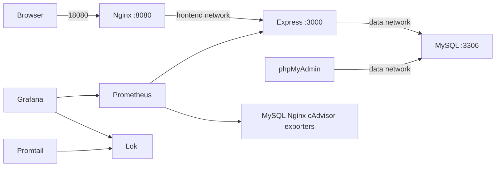

# Báo cáo đồ án — Hệ thống đặt vé xem phim / sự kiện

**[TÊN TRƯỜNG / KHOA]**

[BỘ MÔN / NGÀNH ĐÀO TẠO]

## BÁO CÁO ĐỒ ÁN

TRIỂN KHAI HỆ THỐNG<br>
ĐẶT VÉ XEM PHIM / SỰ KIỆN<br>
TRÊN DOCKER COMPOSE

**Đề tài 11**

**Học phần:** Triển khai và Quản trị Hệ thống Phần mềm

**Sinh viên:** [HỌ VÀ TÊN]

**Mã số sinh viên:** [MÃ SỐ SINH VIÊN]

**Lớp:** [LỚP]    **Giảng viên:** [HỌ TÊN GIẢNG VIÊN]

[TỈNH / THÀNH PHỐ] — 2026

---

## MỤC LỤC VÀ THÔNG TIN ĐỒ ÁN

Báo cáo trình bày quá trình xây dựng một hệ thống đặt vé xem phim mẫu và triển khai toàn bộ thành phần bằng Docker Compose. Phạm vi gồm ứng dụng web, cơ sở dữ liệu MySQL, công cụ quản trị DB, reverse proxy, giám sát metrics, tập trung log và các cấu hình bảo mật nền tảng.

1. Giới thiệu đề tài, mục tiêu và phạm vi
2. Kiến trúc và cấu trúc hệ thống
3. Ứng dụng đặt vé và cơ sở dữ liệu
4. Nginx reverse proxy và security headers
5. Giám sát Prometheus và Grafana
6. Tập trung log Loki, Grafana Alloy và LogQL
7. Hardening và quản lý cấu hình
8. Quy trình triển khai và kiểm thử
9. Minh chứng demo và đánh giá kết quả
10. Quản lý mã nguồn, hạn chế và hướng phát triển
11. Kết luận và tài liệu tham khảo

### Thông tin hệ thống

| Thành phần | Công nghệ | Vai trò |
| --- | --- | --- |
| Ứng dụng | Node.js 22, Express | Hiển thị lịch chiếu, giữ ghế và tạo đặt vé demo |
| Cơ sở dữ liệu | MySQL 8.4 | Lưu phim, lịch chiếu, ghế/vé |
| Quản trị DB | phpMyAdmin 5.2 | Quan sát dữ liệu và schema |
| Proxy và metrics | Nginx, Prometheus, Grafana | Điểm vào web, thu thập và trực quan hóa chỉ số |
| Log | Grafana Alloy, Loki, LogQL | Thu thập, lưu trữ và truy vấn log tập trung |

> Các ô trong ngoặc vuông và khung minh chứng cần được sinh viên thay bằng thông tin, ảnh chụp thực tế sau khi triển khai. Báo cáo không khẳng định ảnh hoặc kết quả chạy chưa được xác nhận.

---

## 1. GIỚI THIỆU ĐỀ TÀI

### 1.1 Bối cảnh

Một website đặt vé dù có giao diện đơn giản vẫn phụ thuộc vào nhiều dịch vụ: web server, ứng dụng, database và các công cụ vận hành. Đóng gói các thành phần trong container giúp mô tả môi trường nhất quán, khởi tạo nhanh và có thể lặp lại trên máy khác. Đề tài tập trung thể hiện luồng triển khai và vận hành đó thay vì xây dựng nền tảng thanh toán thương mại.

### 1.2 Mục tiêu

- Chạy toàn bộ ứng dụng, dữ liệu và công cụ phụ trợ bằng Docker Compose.
- Cho phép xem lịch chiếu, chọn ghế còn trống, nhập thông tin demo và tạo vé có trạng thái thanh toán mô phỏng.
- Đưa lưu lượng website qua Nginx và áp dụng security headers.
- Thu thập chỉ số ứng dụng, database, reverse proxy và container; trực quan hóa qua dashboard.
- Chuyển log container về Loki và cung cấp truy vấn LogQL mẫu.
- Áp dụng nguyên tắc least privilege, cô lập mạng, non-root và không commit secret.

### 1.3 Phạm vi và giả định

Ứng dụng có ba phim demo và các lịch chiếu sinh từ SQL khởi tạo. Giá vé và sức chứa là dữ liệu mẫu. Thông tin khách chỉ lưu ở volume database demo. Giao dịch được đánh dấu `simulated_paid`; không có kết nối cổng thanh toán, email, đăng nhập hay phát hành vé điện tử. Hệ thống được cấu hình chạy cục bộ để trình diễn, không được xem như cấu hình sẵn sàng công khai trên Internet.

### 1.4 Công cụ và phiên bản

Compose v2 điều phối image theo tag phiên bản; Node.js 22 Alpine chạy ứng dụng; MySQL 8.4 lưu dữ liệu; Prometheus scrape mỗi 15 giây; Grafana provision datasource/dashboard; Loki giữ log tối đa 7 ngày. Các image cần được cập nhật có kiểm soát và quét lỗ hổng trước khi triển khai dài hạn.

> Kết quả kỳ vọng: một lệnh `docker compose up -d --build` khởi động stack, website được truy cập qua proxy, DB tool thao tác được dữ liệu và các trang giám sát/log hiển thị được dữ liệu mới.

---

## 2. KIẾN TRÚC VÀ CẤU TRÚC HỆ THỐNG

Kiến trúc tách luồng phục vụ người dùng khỏi luồng lưu trữ và quan sát. Nginx là điểm vào của website. Ứng dụng Express chỉ nhận kết nối nội bộ từ Nginx; nó truy cập MySQL qua network dữ liệu. phpMyAdmin có cổng host riêng chỉ bind loopback. Prometheus cần kết nối tới các target metrics trên các network tương ứng; Grafana dùng Prometheus và Loki làm datasource.



*Hình 1. Sơ đồ thành phần và các luồng truy cập chính.*

### 2.1 Network và volume

`frontend` nối Nginx với app; `data` là mạng internal nối app, MySQL và phpMyAdmin; `observability` là mạng internal cho hệ thống metrics/log; `management` nối phpMyAdmin/Grafana tới các cổng host chỉ bind loopback. Dữ liệu MySQL, Prometheus, Grafana và Loki được lưu trong named volume để vẫn còn sau khi container được tạo lại. Lệnh `docker compose down -v` xóa dữ liệu volume nên chỉ dùng khi chủ động reset demo.

---

## 3. ỨNG DỤNG ĐẶT VÉ VÀ CƠ SỞ DỮ LIỆU

### 3.1 Luồng nghiệp vụ

Trình duyệt tải danh sách qua `GET /api/movies`; mỗi dòng lịch chiếu có thông tin phim, phòng, giờ, giá và số ghế trống. Khi người dùng chọn lịch, giao diện gọi `GET /api/screenings/:id/seats` để nhận trạng thái từng ghế. API đặt vé nhận screening ID, danh sách ghế, họ tên và email; dữ liệu được kiểm tra kiểu, giới hạn số ghế, độ dài và định dạng email trước khi truy vấn DB.

Trong transaction, ứng dụng khóa dòng lịch chiếu, kiểm tra lịch chưa bắt đầu, ghế nằm trong sức chứa và chưa có vé. Lệnh chèn nhiều vé được bảo vệ thêm bởi unique key theo cặp lịch chiếu/ghế. Khóa dòng lịch chiếu giúp các yêu cầu đặt song song trên cùng buổi chiếu lần lượt kiểm tra trạng thái, còn unique key là lớp bảo vệ cuối cùng chống đặt trùng.

### 3.2 Mô hình dữ liệu

| Bảng | Trường và quan hệ | Mục đích |
| --- | --- | --- |
| `movies` | id, title, description, genre, duration_minutes | Danh mục phim mẫu |
| `screenings` | movie_id → movies.id, starts_at, room_name, seat_capacity, ticket_price | Suất chiếu và sức chứa |
| `bookings` | screening_id → screenings.id, seat_number, customer_name/email, payment_status | Mỗi hàng là một ghế đã đặt; unique (screening_id, seat_number) |

### 3.3 Quản trị DB và dữ liệu khởi tạo

MySQL tạo schema và dữ liệu demo ở lần khởi tạo volume đầu tiên. Compose tạo account ứng dụng với quyền trên database chỉ định; không kết nối ứng dụng bằng root. phpMyAdmin kết nối tới hostname nội bộ `db` và cho phép kiểm tra bản ghi khi demo. Cổng của công cụ chỉ được publish trên loopback của máy.

> **Lưu ý dữ liệu:** email/tên trong form là dữ liệu demo. Không dùng thông tin cá nhân thật; volume cục bộ không có chính sách mã hóa/backup dành cho dữ liệu sản xuất.

### 3.4 API và lỗi

`/healthz` kiểm tra kết nối DB; `/metrics` xuất chỉ số Prometheus. API trả 400 cho đầu vào sai, 404 cho lịch không tồn tại, 409 cho ghế đã đặt và 500 cho lỗi hệ thống. Log lỗi chỉ ghi thông tin kỹ thuật cơ bản; không trả chi tiết SQL cho trình duyệt.

---

## 4. NGINX REVERSE PROXY VÀ SECURITY HEADERS

### 4.1 Reverse proxy

Người dùng đi vào cổng host 18080 được bind ở 127.0.0.1. Nginx trong container lắng nghe 8080 và chuyển tiếp request đến upstream `app:3000` qua network Compose. Các header Host, địa chỉ client và scheme được chuyển tiếp; các timeout kết nối/đọc có giới hạn. Port 3000 của app chỉ được khai báo expose, không publish ra host.

Endpoint `/nginx_status` bật stub status cho exporter và giới hạn địa chỉ trong dải mạng private Docker. Nginx exporter đọc endpoint này; endpoint không cần xuất hiện trong website công khai. Nginx ghi access/error log ra stdout/stderr để Docker logging driver và Promtail thu nhận.

### 4.2 Security headers

| Header | Tác dụng |
| --- | --- |
| Content-Security-Policy | Giới hạn nguồn script/style/font, chặn framing, giới hạn base/form |
| X-Content-Type-Options: nosniff | Ngăn trình duyệt tự suy đoán MIME type |
| X-Frame-Options: DENY | Không cho nhúng trang trong frame |
| Referrer-Policy | Hạn chế thông tin referrer khi điều hướng khác origin |
| Permissions-Policy | Tắt camera, microphone và geolocation không sử dụng |

### 4.3 HTTPS và giới hạn

Đề bài chấp nhận HTTPS tự ký hoặc security headers cơ bản; cấu hình demo sử dụng lựa chọn security headers. Vì vậy website dùng HTTP cục bộ, chưa mã hóa lưu lượng qua Internet. Triển khai bên ngoài máy cần đặt TLS termination, certificate tin cậy, redirect HTTP→HTTPS và cân nhắc HSTS sau khi HTTPS ổn định. Header CSP cần được điều chỉnh nếu thêm nguồn tài nguyên bên thứ ba hoặc chức năng mới.

> Kiểm tra demo: DevTools → Network → response headers; hoặc chạy `curl -I http://localhost:18080`. Ghi lại các header thực tế vào minh chứng sau khi stack khởi động.

### 4.4 Phòng thủ theo lớp

Nginx giới hạn kích thước request body, ẩn phiên bản server và có timeout. Express tắt header X-Powered-By, dùng Helmet và giới hạn JSON body. Các biện pháp này giảm bề mặt tấn công thông thường nhưng không thay thế xác thực, rate limit, HTTPS, kiểm thử và cập nhật phần mềm.

---

## 5. GIÁM SÁT PROMETHEUS VÀ GRAFANA

### 5.1 Thu thập metrics

Prometheus cấu hình scrape interval 15 giây và các job riêng: Prometheus tự giám sát; endpoint metrics ứng dụng; MySQL exporter; Nginx exporter; cAdvisor. Dữ liệu time-series lưu ở named volume với retention 15 ngày. Prometheus Targets cho phép xác nhận địa chỉ target, thời gian scrape và lỗi gần nhất.

| Job | Target | Chỉ số minh họa |
| --- | --- | --- |
| cinema-app | app:3000/metrics | request theo HTTP method/status, số vé đặt, Node.js process/runtime |
| mysql | mysql-exporter:9104 | kết nối, truy vấn, trạng thái InnoDB/threads |
| nginx | nginx-exporter:9113 | kết nối active/reading/writing/waiting |
| containers | cadvisor:8080 | CPU, memory và hoạt động container |

### 5.2 Dashboard

Grafana provision datasource Prometheus và Loki, sau đó nạp dashboard tệp JSON có sẵn. Dashboard minh họa request rate, tổng lượt vé được đặt, CPU và memory container, kết nối database/web server, lượng truy vấn. Người vận hành có thể thay time range và mở panel Explore để chạy truy vấn trực tiếp.

```text
sum by (status) (rate(cinema_http_requests_total[5m]))
sum(cinema_bookings_created_total)
container_memory_working_set_bytes{name!=""}
mysql_global_status_threads_connected
nginx_connections_active
```

### 5.3 Đọc và diễn giải

Counter tổng request/booking chỉ tăng, nên cần dùng `rate()` để đọc tốc độ thay đổi trong một cửa sổ. Gauge như số kết nối/bytes thể hiện giá trị gần thời điểm scrape. Dashboard demo không thiết lập cảnh báo SLO; một counter bằng 0 có thể do chưa có request trong thời gian chạy chứ không đồng nghĩa hỏng dịch vụ. Các metric cAdvisor phụ thuộc host Docker và có thể thiếu trên Docker Desktop.

### 5.4 Bằng chứng cần chụp

Chụp trang Prometheus Targets có các job up; Grafana dashboard sau khi tạo vài request và một booking demo; trang Explore với một PromQL query. Không chụp hoặc công khai mật khẩu Grafana.

---

## 6. TẬP TRUNG LOG LOKI, GRAFANA ALLOY VÀ LOGQL

### 6.1 Pipeline log

Các container sử dụng Docker json-file logging với giới hạn 10 MB mỗi file, tối đa 3 file/container. Ứng dụng ghi log request lỗi/health-check lỗi ra stderr; Nginx ghi access và error log ra stdout/stderr. Grafana Alloy (collector kế nhiệm Promtail, Promtail đã EOL tháng 3/2026) phát hiện container qua Docker Engine API proxy, gắn nhãn project/service/container, parse JSON để trích xuất label `level` và đẩy các dòng đến Loki qua mạng nội bộ. Grafana truy vấn Loki bằng datasource được provision sẵn.

Docker socket có quyền lớn nếu truy cập trực tiếp. Thiết kế dùng docker-socket-proxy, chỉ bật API cần cho container discovery/events/network metadata và tắt POST; proxy không publish cổng ra host. Đây vẫn là thành phần nhạy cảm cần hạn chế network và cập nhật image.

### 6.2 Truy vấn LogQL mẫu

```text
{project="cinema-platform"}
{project="cinema-platform", service="nginx"} |= "POST /api/bookings"
{project="cinema-platform", service="nginx"} |~ " 4[0-9][0-9] "
```

Truy vấn đầu xem toàn bộ log trong project; truy vấn thứ hai tìm các request đặt vé; truy vấn thứ ba tìm dòng Nginx có mã HTTP 4xx. Nhãn project phụ thuộc tên project Compose; nếu người chạy đặt tên khác, có thể lọc chỉ bằng `{service="nginx"}` hoặc kiểm tra nhãn thực trong Grafana Explore. Cần chọn khoảng thời gian chứa log mới.

### 6.3 Retention và dung lượng

Loki chạy single-process cho demo, dùng filesystem storage, retention cấu hình 7 ngày. Named volume giúp dữ liệu log tồn tại khi container restart. Dung lượng phụ thuộc lưu lượng và verbosity; log không nên chứa mật khẩu, token, thông tin thẻ hoặc dữ liệu định danh nhạy cảm. Khi chạy thật cần thiết lập giới hạn volume, chính sách backup, phân quyền truy vấn và kiểm tra hiệu quả compactor/retention.

### 6.4 Kiểm thử log

1. Mở website để sinh access log.
2. Gửi request sai đường dẫn hoặc dữ liệu không hợp lệ để sinh status 4xx.
3. Trong Grafana → Explore → Loki chọn Last 15 minutes, chạy ba truy vấn mẫu.
4. Chụp ảnh kết quả có label và timestamp, không đưa dữ liệu khách thật vào ảnh.

> Loki không tự index toàn bộ nội dung như một hệ quản trị quan hệ; cần lọc nhãn trước, sau đó áp dụng bộ lọc chuỗi/regex phù hợp để truy vấn hiệu quả.

---

## 7. HARDENING VÀ QUẢN LÝ CẤU HÌNH

### 7.1 Các lớp bảo vệ đã cấu hình

| Biện pháp | Cách áp dụng | Ý nghĩa / lưu ý |
| --- | --- | --- |
| Non-root | Express chạy user node; Nginx chạy UID/GID 101 | Giảm hậu quả nếu tiến trình ứng dụng bị chiếm; kiểm tra writable path nếu thêm tính năng. |
| Filesystem read-only | App và Nginx bật read_only; tmpfs riêng cho tệp tạm/pid | Hạn chế ghi tùy ý vào filesystem container. |
| Least privilege | DB account app không phải root; exporter có user đọc/metrics riêng | Tách quyền chạy ứng dụng khỏi quyền quản trị DB. |
| Network isolation | Network data và observability internal; DB/Loki không publish port | Giảm dịch vụ có thể truy cập từ host/mạng bên ngoài. |
| Capabilities | App/Nginx drop all; no-new-privileges cho nhiều service | Không cấp quyền Linux không cần thiết. |
| Secret handling | .env bị ignore; chỉ commit .env.example | Người triển khai tự tạo password, không dùng mật khẩu mẫu. |
| HTTP headers | CSP, nosniff, frame/referrer/permissions policy | Phòng một số nhóm lỗi phía trình duyệt; cần rà soát khi thay đổi asset. |

### 7.2 Mật khẩu và tài khoản

MySQL root password, app password, exporter password và Grafana password là cấu hình runtime. Hãy tạo giá trị ngẫu nhiên riêng, dài; không tái sử dụng mật khẩu. Script khởi tạo exporter chỉ chấp nhận tập ký tự đã giới hạn và yêu cầu tối thiểu 32 ký tự để tránh SQL injection qua giá trị cấu hình. App dùng bind parameter cho dữ liệu người dùng. Có thể thay bằng Docker secrets/Vault khi triển khai môi trường lớn hơn.

### 7.3 Threat model ngắn

Tài sản cần bảo vệ: dữ liệu booking, tài khoản DB, secret, log và quyền Docker host. Rủi ro chính gồm secret bị commit, truy cập trái phép phpMyAdmin/Grafana, đặt trùng ghế đồng thời, log lộ PII, container bị khai thác và Docker socket bị lạm dụng. Kiểm soát hiện tại giảm bề mặt nhưng chưa triển khai đăng nhập khách hàng, chống bot/rate limiting, TLS public, backup/restore, cảnh báo và kiểm thử xâm nhập.

> Không bật cổng quản trị ra Internet. Không đưa Docker socket proxy ra khỏi network quan sát. Bảo vệ host Docker là điều kiện quan trọng vì quyền Docker thường tương đương quyền quản trị máy.

---

## 8. QUY TRÌNH TRIỂN KHAI VÀ KIỂM THỬ

### 8.1 Các bước cài đặt

1. Cài Docker Desktop, bật Linux containers và kiểm tra `docker compose version`.
2. Sao chép `.env.example` thành `.env`, thay tất cả mật khẩu bằng secret riêng.
3. Chạy `docker compose config` để xác thực YAML và biến môi trường.
4. Chạy `docker compose up -d --build`, đợi DB health check và các service khởi động.
5. Mở website, phpMyAdmin, Prometheus, Grafana; tạo request/booking demo.
6. Truy vấn dashboard/LogQL và chụp ảnh thực tế để đưa vào mục minh chứng.

| Thành phần | Cổng host | Địa chỉ truy cập |
| --- | --- | --- |
| Website qua Nginx | 18080 | http://localhost:18080 |
| phpMyAdmin | 18081 | http://localhost:18081 |
| Grafana | 13000 | http://localhost:13000 |
| Prometheus | 19090 | http://localhost:19090 |

Các cổng host này được cấu hình trong file `.env` hiện tại và chỉ bind trên loopback; nếu thay đổi biến cổng, cập nhật địa chỉ tương ứng. Cổng 8080 của Nginx và 3000 của ứng dụng là cổng nội bộ container.

### 8.2 Ma trận kiểm thử

| Ca kiểm thử | Kết quả mong đợi | Thực tế / ghi chú |
| --- | --- | --- |
| Compose config | Cấu hình hợp lệ, không thiếu biến bắt buộc | [Điền khi chạy] |
| Health API | HTTP 200, database connected | [Điền khi chạy] |
| Danh sách lịch chiếu | API trả các suất tương lai và số ghế trống | [Điền khi chạy] |
| Đặt ghế hợp lệ | 201, bản ghi xuất hiện trong bookings | [Điền khi chạy] |
| Đặt lại ghế trùng | 409, không tạo vé thứ hai cho ghế đó | [Điền khi chạy] |
| Monitoring | Prometheus targets UP, dashboard có dữ liệu | [Điền khi chạy] |
| LogQL | Ba truy vấn trả log đúng nhãn/dòng | [Điền khi chạy] |
| Security headers | Response có các header đã cấu hình | [Điền khi chạy] |

### 8.3 Vận hành vòng đời

`docker compose down` dừng dịch vụ nhưng giữ named volume. Cấu hình init DB chỉ chạy khi volume rỗng, nên thay đổi SQL không tự áp dụng vào DB đã tồn tại. Chỉ reset bằng `docker compose down -v` khi chấp nhận mất dữ liệu demo. Khi gặp lỗi, kiểm tra `docker compose ps` và log của service liên quan; không khắc phục bằng cách mở rộng quyền root hoặc expose thêm port nếu chưa cần.

---

## 9. MINH CHỨNG DEMO VÀ ĐÁNH GIÁ KẾT QUẢ

Thay các khung bên dưới bằng screenshot do sinh viên tự chụp sau khi chạy stack. Ảnh nên có thanh địa chỉ hoặc tên giao diện để nhận diện đúng dịch vụ, đồng thời che mật khẩu/email hoặc dữ liệu cá nhân. Có thể chụp bằng Snipping Tool trên Windows và chèn trực tiếp vào báo cáo.

### Minh chứng 1 — Website và chọn ghế

> **Minh chung:** Chèn screenshot website tại http://localhost:18080 Hiển thị lịch chiếu và thao tác chọn ghế demo

### Minh chứng 2 — phpMyAdmin

> **Minh chung:** Chèn ảnh cấu trúc bảng và một bản ghi demo trong bookings Không để lộ mật khẩu hoặc thông tin khách thật

### Minh chứng 3 — Prometheus Targets

> **Minh chung:** Chèn screenshot Prometheus Targets tại http://localhost:19090/targets Thể hiện các target đang UP; bổ sung ảnh dashboard Grafana

### Minh chứng 4 — LogQL / hardening

> **Minh chung:** Chèn ảnh LogQL query có kết quả; kèm ảnh response headers hoặc docker compose ps

### Đánh giá theo tiêu chí

| Tiêu chí | Đối chiếu | Minh chứng nên nộp |
| --- | --- | --- |
| GitHub | Source/config/README, ba commit có ý nghĩa | Link repo, trang commit history |
| Ứng dụng + DB | Đặt vé, MySQL, phpMyAdmin | Website và bản ghi bookings |
| Nginx | Reverse proxy và security headers | URL :18080 và response headers |
| Metrics | Prometheus scrape, Grafana dashboard | Targets và panels |
| Logs | Loki, Grafana Alloy và ít nhất 2–3 LogQL | Explore có kết quả query |
| Hardening | Non-root, network, secrets, headers, DB roles | Compose/config và demo |

---

## 10. QUẢN LÝ MÃ NGUỒN, HẠN CHẾ VÀ PHÁT TRIỂN

### 10.1 Quản lý GitHub

Tạo repository có tên mã số sinh viên, ví dụ `<MSSV>`, ở chế độ phù hợp yêu cầu môn học. Commit theo ba mốc: (1) ứng dụng, MySQL/phpMyAdmin và reverse proxy; (2) Prometheus, exporters và dashboard Grafana; (3) Loki/Promtail, hardening và tài liệu. Mỗi commit nên chứa thay đổi liên quan, có thông điệp rõ ràng. Đưa README, file cấu hình Compose và báo cáo vào repository; loại trừ `.env`, secrets và dữ liệu database.

Trong repository hiện tại, sinh viên cần tạo remote bằng tài khoản GitHub cá nhân, push branch chính, rồi ghi URL repository vào bìa/phần phụ lục. Không chia sẻ token GitHub trong báo cáo hoặc chat. Không tạo commit có email, mật khẩu thật hay dữ liệu cá nhân.

### 10.2 Hạn chế

- Giao dịch thanh toán không kết nối nhà cung cấp, không có hoàn tiền hoặc xác nhận đối soát.
- Không có tài khoản người dùng, phân quyền admin/khách, xác minh email hay chống spam.
- HTTP cục bộ chưa cung cấp TLS; dashboard chưa có alerting hoặc SLO.
- Single-node MySQL/Loki không có HA; chưa cấu hình backup/restore tự động.
- cAdvisor và truy cập Docker logs có thể khác nhau giữa Linux Engine và Docker Desktop.
- Ảnh minh chứng và trường thông tin sinh viên cần được bổ sung thủ công.

### 10.3 Hướng phát triển

Thêm xác thực và RBAC, mã hóa secret, HTTPS tự động, rate limiting, kiểm thử tích hợp/đồng thời, migration versioned, backup định kỳ, cảnh báo Prometheus, dashboard chuyên biệt, tracing OpenTelemetry và chính sách retention/PII. Với lượng tải lớn hơn, có thể tách hàng đợi, cache, database managed và lưu trữ object thay cho filesystem local.

### 10.4 Tài liệu tham khảo

1. Docker Docs, Compose file reference — `docs.docker.com/compose/`.
2. Express.js documentation — `expressjs.com`.
3. MySQL 8.4 Reference Manual — `dev.mysql.com/doc/refman/8.4/en/`.
4. Prometheus documentation — `prometheus.io/docs/`.
5. Grafana, Loki, Promtail documentation — `grafana.com/docs/`.
6. Nginx documentation — `nginx.org/en/docs/`.

---

## 11. KẾT LUẬN

Đề tài đã thiết kế một hệ thống web đặt vé phim mẫu theo mô hình nhiều container được điều phối bằng Docker Compose. Luồng ứng dụng minh họa cách trình duyệt đi qua Nginx tới Express, cách ứng dụng kiểm tra đầu vào và dùng transaction/constraint để giữ ghế, cũng như cách kiểm tra dữ liệu qua phpMyAdmin.

Nhóm monitoring cho thấy metrics của app, proxy, DB và container có thể được thu thập tập trung bằng Prometheus, sau đó quan sát qua Grafana. Nhóm logging chuyển log Docker về Loki và cung cấp các truy vấn LogQL để lọc theo service, chuỗi lỗi và mã phản hồi. Network nội bộ, container non-root/read-only, quyền DB tách biệt, security headers và secret ngoài Git là các biện pháp hardening được áp dụng trong phạm vi demo.

Việc hoàn thành và đánh giá kết quả cần được xác nhận bằng cách chạy stack trên máy triển khai, kiểm tra từng ca trong ma trận, chụp minh chứng thật và push repository lên GitHub. Đây là nền tảng học tập để tiếp tục thực hành vận hành, bảo mật và mở rộng hệ thống; không phải giải pháp đặt vé/thanh toán production.

> **Thông tin nộp bài cần hoàn thiện:** điền danh tính sinh viên và giảng viên; thay các ô ảnh minh chứng; ghi URL GitHub; cập nhật kết quả kiểm thử thực tế; xuất bản in A4 thành PDF để xác nhận số trang.

**— HẾT —**
